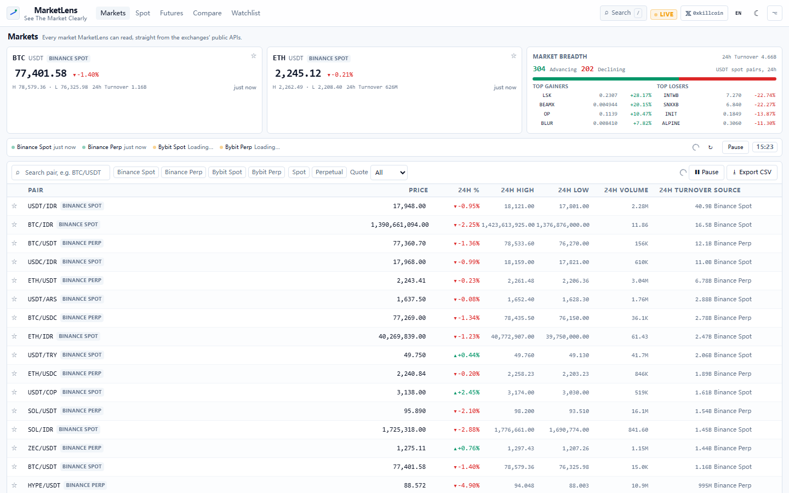
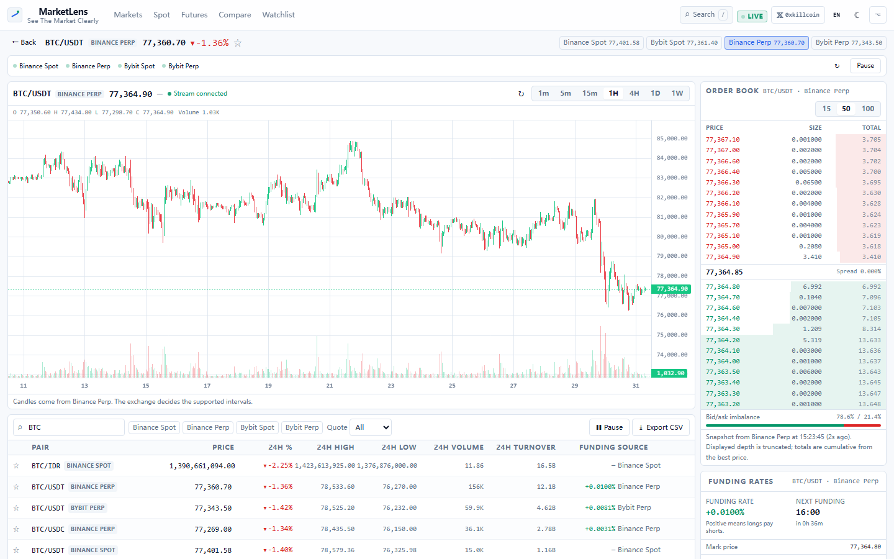
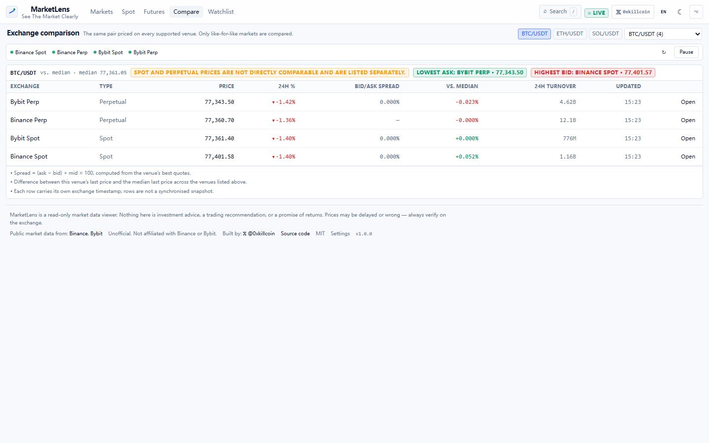
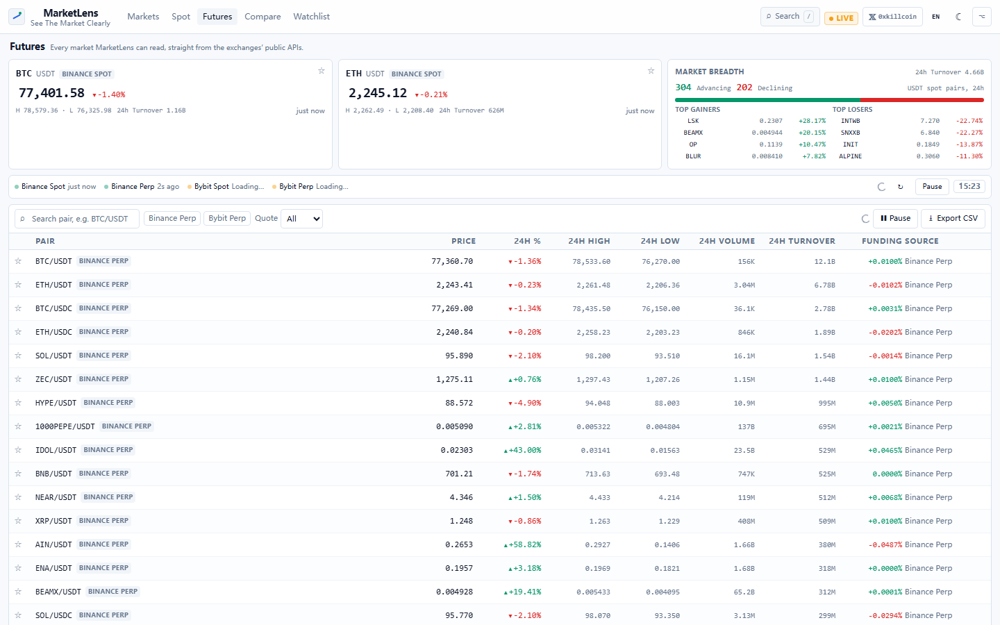
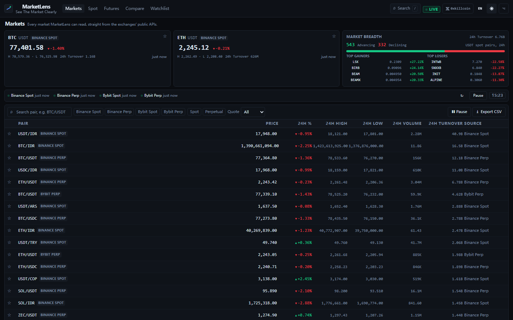
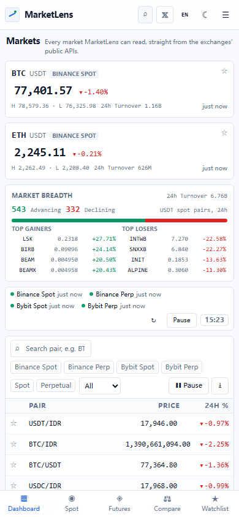
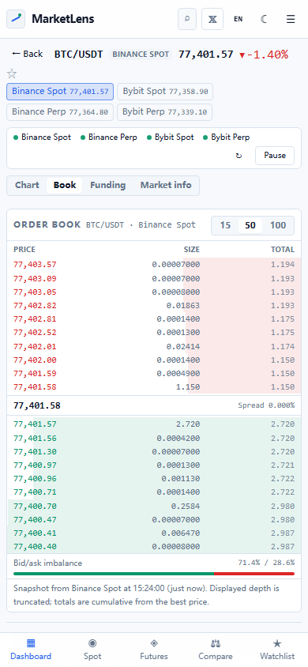

<div align="center">

# MarketLens

**See The Market Clearly · 把加密市场装进一个屏幕**

A free, open-source crypto market dashboard. Spot and perpetual futures from Binance and Bybit
in one dense terminal-grade screen — no account, no API key, no backend.

[](https://github.com/iiiiiiiiiiiiiKK/marketlens/actions/workflows/ci.yml)
[](https://github.com/iiiiiiiiiiiiiKK/marketlens/actions/workflows/deploy.yml)
[](LICENSE)
[](package.json)

[**Live demo**](https://iiiiiiiiiiiiikk.github.io/marketlens/) · [简体中文说明](README.zh-CN.md) · Author on X: [**@0xkillcoin**](https://x.com/0xkillcoin)

</div>



---

## Why this exists

Most "crypto dashboards" are one of two things: a paid API wrapper that needs a
signup and a key, or a pretty mock-up with hard-coded numbers. MarketLens is
neither. It is a **read-only lens** over the public market-data endpoints the
exchanges already expose: every price, candle, order book level and funding rate
you see came from a real HTTP response or websocket frame in your own browser, and
every one of them carries its source and timestamp.

**What it is:** a market observer. **What it is not:** a trading bot, a portfolio
tracker, a signal service, or an investment-advice product.

- No sign-up, no login, no exchange account linking, no API keys.
- No backend to trust — the entire product is a static bundle you can host on a CDN.
- No simulated prices. If an endpoint fails, the panel says so instead of inventing data.
- No analytics, no cookies, no trackers.

## Features

| | |
|---|---|
| **Market overview** | BTC / ETH reference cards, market breadth (advancing vs declining), 24h turnover, top gainers and losers — all derived from live USDT spot pairs. |
| **One table for four venues** | Binance Spot, Binance USDⓈ-M Perpetual, Bybit Spot and Bybit Perpetual side by side, with sorting, search, exchange / market-type / quote filters and windowed rendering for ~4,500 rows. |
| **Candles that are actually candles** | Lightweight Charts® candles + volume from the venue's own kline endpoint, 1m → 1w, with a live websocket tick streaming into the newest bar. |
| **Order book** | Bids, asks, cumulative totals, depth bars, bid/ask imbalance and a live spread figure, refreshable depth (15 / 50 / 100 levels). |
| **Funding rates** | Current rate, next settlement countdown, funding history with a signed bar chart — perpetuals only, and the UI explicitly refuses to show funding for spot markets. |
| **Exchange comparison** | The same pair across every venue that lists it: last price, 24h change, turnover, best bid/ask, spread (formula shown) and deviation from the median. |
| **Watchlist** | Multiple groups, drag-free reordering, stars from any table, persisted in `localStorage`. |
| **CSV export** | Per-row exchange timestamps, local receive time and the endpoint that produced the row — never disguised as one synchronised snapshot. |
| **Live / stale honesty** | Websocket status, per-source freshness, "paused" state, offline banner, explicit rate-limit and timeout messages. |
| **Bilingual + themable** | 简体中文 / English with browser detection and persistence; dark (default) and light themes. |
| **Mobile-first responsive** | Bottom tab bar, dedicated chart / book / funding tabs, horizontally scrollable tables, 44px-class touch targets, no horizontal page scroll. |

<div align="center">

| Pair workstation | Exchange comparison |
|---|---|
|  |  |

| Futures + funding | Light theme |
|---|---|
|  |  |

| Mobile dashboard | Mobile order book |
|---|---|
|  |  |

</div>

## Data sources

Everything is **public, read-only and CORS-enabled**; there is no proxy in the
middle. Each adapter lives in `src/data/` and is verified against the venue's own
documentation and live responses.

| Venue | Market | Endpoints used | Docs |
|---|---|---|---|
| Binance | Spot | `/api/v3/exchangeInfo`, `/api/v3/ticker/24hr`, `/api/v3/klines`, `/api/v3/depth`, `wss://stream.binance.com:9443/ws/<symbol>@miniTicker` | [Binance Spot API](https://developers.binance.com/docs/binance-spot-api-docs) |
| Binance | USDⓈ-M Perpetual | `/fapi/v1/exchangeInfo`, `/fapi/v1/ticker/24hr`, `/fapi/v1/premiumIndex`, `/fapi/v1/klines`, `/fapi/v1/depth`, `/fapi/v1/fundingRate`, `wss://fstream.binance.com/ws/<symbol>@miniTicker` | [USDⓈ-M Futures API](https://developers.binance.com/docs/derivatives/usds-margined-futures) |
| Bybit | Spot | `/v5/market/instruments-info`, `/v5/market/tickers`, `/v5/market/kline`, `/v5/market/orderbook`, `wss://stream.bybit.com/v5/public/spot` | [Bybit V5 API](https://bybit-exchange.github.io/docs/v5/intro) |
| Bybit | Linear Perpetual | `/v5/market/instruments-info`, `/v5/market/tickers`, `/v5/market/kline`, `/v5/market/orderbook`, `/v5/market/funding/history`, `wss://stream.bybit.com/v5/public/linear` | [Bybit V5 API](https://bybit-exchange.github.io/docs/v5/intro) |

Only instruments that the venue reports as `TRADING` (and, for derivatives,
`PERPETUAL`) are listed. A delisted or non-trading symbol silently disappearing
from the exchange is *not* papered over with a cached row.

### Refresh model and rate limits

- **Ticker polling**: one request per source per tick. Default interval 10s
  (configurable 5–60s in Settings). Requests are de-duplicated (identical URLs in
  the same 400ms window share one call), never overlap, pause when the tab is
  hidden, and back off after repeated total failures.
- **Request weight actually observed** from the `X-MBX-USED-WEIGHT-1M` response
  header at the time this was written: Binance spot `/ticker/24hr` (all symbols)
  = **80**, spot `/depth` (100 levels) = **5**, Binance futures `/ticker/24hr`
  (all symbols) ≈ **40–50**, futures `/premiumIndex` (all) = **10**,
  futures `/depth` = **5–7**. At the default 10s cadence the app spends roughly
  480 spot weight and 350 futures weight per minute — a small fraction of the
  per-IP budgets published in the exchange docs.
- **Instrument metadata** (`exchangeInfo` / `instruments-info`) is cached for 30
  minutes, so symbol directories are not re-downloaded on every tick.
- **Websockets** are opened only for the market currently on screen and are
  reference-counted: when the last subscriber unmounts (or you switch market) the
  socket is closed. If the stream cannot connect, the app keeps polling and says
  so — `Stream disconnected — polling`.
- Bybit exposes no rate-limit headers, so MarketLens self-limits by never issuing
  more than one in-flight request per endpoint.

## Architecture

```
src/
├── data/                  # one adapter per venue + the polling/stream engines
│   ├── base.ts            # MarketAdapter contract + normalisers (tickers, candles, ladders)
│   ├── binanceSpot.ts     # Binance spot
│   ├── binanceFutures.ts  # Binance USDⓈ-M perpetuals (24h ticker + premiumIndex merge)
│   ├── bybit.ts           # shared Bybit v5 plumbing (kline codes, pagination, ratio→percent)
│   ├── bybitSpot.ts       # Bybit spot
│   ├── bybitLinear.ts     # Bybit linear perpetuals (funding)
│   ├── liveTicker.ts      # ref-counted websocket manager, capped exponential backoff
│   ├── controller.ts      # single-flight polling loop, visibility/offline aware
│   └── index.ts           # registry, labels, id parsing
├── hooks/                 # useKlines / useOrderBook / useFunding / useLiveTicker / useMediaQuery…
├── lib/                   # types, formatting, http (timeout + dedupe), i18n, selectors, csv, router
├── store/                 # zustand stores: markets (source state), settings, watchlist
├── components/            # nav, hero, table (virtualised), chart, order book, funding, palette, ui kit
├── views/                 # TableView (markets/spot/futures), PairView, CompareView, WatchlistView, SettingsView
├── App.tsx                # shell, hash router, error boundaries, offline banner
└── index.css              # design tokens (dark/light) + Tailwind layers
```

**Data flow:** `MarketAdapter.fetchTickers()` → normalised `MarketTicker[]` →
`useMarkets` store (per-source `status / updatedAt / error`) → pure selectors
(`src/lib/selectors.ts`) → components. Nothing in the UI computes a price by
itself, and no component talks to the network directly except through a hook or
the controller.

**Isolation:** every source has its own state slot. One exchange returning HTTP
429 degrades only its own rows/badge; the rest of the dashboard keeps updating.
Each view is wrapped in an `ErrorBoundary`, and each panel has explicit
loading / empty / error / stale states.

## Quick start

```bash
git clone https://github.com/iiiiiiiiiiiiiKK/marketlens.git
cd marketlens
npm install
npm run dev          # http://localhost:5173
```

Requirements: Node 20+ and a modern browser. **No environment variables, no
secrets, no `.env` file** — the app only talks to public endpoints.

| Command | What it does |
|---|---|
| `npm run dev` | Vite dev server with HMR |
| `npm run build` | Typecheck (`tsc --noEmit`) then production bundle in `dist/` |
| `npm run preview` | Serve the built bundle locally |
| `npm run lint` | ESLint (flat config, typescript-eslint, react-hooks) |
| `npm run typecheck` | `tsc --noEmit` |
| `npm test` | Vitest unit + component tests |
| `npm run test:e2e` | Playwright: 20 deterministic UI tests (desktop + iPhone 13) |
| `npx playwright test --project=live` | 4 live tests against the real exchange APIs |
| `npx playwright test --project=screenshots` | Regenerates `docs/screenshots/` |
| `node scripts/smoke.mjs <url> [--proxy <url>]` | Production smoke check against a deployed URL (desktop + mobile, real data) |
| `npm run verify` | lint + tests + build |

## Testing

| Suite | Command | Result at time of writing |
|---|---|---|
| ESLint (flat config) | `npm run lint` | **0 errors, 0 warnings** |
| TypeScript strict | `npm run typecheck` | **0 errors** |
| Unit / component (Vitest + Testing Library) | `npm test` | **108 passed / 10 files** |
| E2E UI (Playwright, mocked exchange fixtures) | `npx playwright test --project=desktop --project=mobile` | **20 passed** (10 desktop + 10 iPhone 13) |
| E2E live (Playwright, real APIs) | `npx playwright test --project=live` | **4 passed** |
| Production build | `npm run build` | **success** (~340 kB app chunk, ~167 kB chart chunk) |

What the suites actually cover:

- **Adapters**: payload → domain mapping for all four venues, Bybit's ratio-based
  percentages, kline reversal, weight/depth snapping, non-`TRADING` filtering,
  `retCode` failures surfaced as errors, funding present only for perpetuals.
- **Selectors**: search normalisation, multi-dimensional filtering, sorting with
  nulls last, breadth maths (spot-USDT only, no perp double counting), compare
  rows with median/deviation, reference-venue preference.
- **Streams**: socket sharing and ref-counted teardown, Binance/Bybit frame
  parsing, foreign-symbol frames ignored, reconnect backoff, no reconnect after the
  last subscriber leaves.
- **Stores**: watchlist toggle/reorder/groups and persistence round-trip (including
  corrupted-storage recovery), theme/language application and persistence.
- **UI**: virtualised table rendering, filtering, sorting, starring, pause/resume,
  CSV export, skeletons, explicit error states, funding "not applicable" for
  spot, segmented controls' ARIA state, i18n key parity and no empty strings.
- **E2E**: dashboard from four sources, search → pair view with chart + book +
  funding, watchlist persistence across reload, theme/language persistence, compare
  view formula disclosure, CSV download filename, single-source failure
  degradation, mobile tab bar with no horizontal page scroll, author 𝕏 link.

## Deployment

The build is a static bundle — any CDN works. `VITE_BASE` controls the public path.

### GitHub Pages (this repo, automatic)

`.github/workflows/deploy.yml` builds with `VITE_BASE=/marketlens/` and publishes
`dist/` through the Pages artifact flow. Enable it once in the repository:

1. **Settings → Pages → Build and deployment → Source: GitHub Actions.**
2. Push to `main` (or run the workflow manually).
3. The site appears at `https://<user>.github.io/marketlens/`.

Because routing is hash-based (`#/pair/binance-spot/BTCUSDT`), no rewrite rules
or 404 shims are needed.

### Cloudflare Pages

| Setting | Value |
|---|---|
| Framework preset | None / Vite |
| Build command | `npm run build` |
| Build output directory | `dist` |
| Env var | `VITE_BASE=/` (root) or omitted |

Free tier: 500 builds/month, unlimited static requests, global CDN. No Functions
required — MarketLens is pure static.

### Vercel

| Setting | Value |
|---|---|
| Framework | Vite |
| Build command | `npm run build` |
| Output directory | `dist` |
| Env var | `VITE_BASE=/` (root) or omitted |

### Self-hosting

```bash
VITE_BASE=/ npm run build      # then serve dist/ with any static file server
```

## Privacy and security

- **No backend, no database, no server-side secrets.** The repository contains
  zero credentials; nothing is read from `.env`.
- **No account, no API keys, no trading endpoints.** The app can only read public
  market data; there is no code path that can place an order, move funds or read a
  balance. No exchange credentials are ever requested or stored.
- **No analytics, no cookies, no fingerprinting, no third-party scripts.** Fonts
  are system fonts; the only external requests are the exchange endpoints listed
  above.
- **Local-only persistence.** `marketlens.settings.v1` (theme / language /
  refresh interval) and `marketlens.watchlist.v1` (groups + starred markets) live in
  your browser's `localStorage`. Clearing site data removes them.
- **Honest failure.** Timeouts, 429/418/451 rate limits, malformed payloads and
  CORS/network failures are surfaced with a human-readable reason and a retry,
  never replaced by cached or synthetic numbers. Stale rows stay visible but the
  source badge flips to an error state and the age is shown.
- **Your IP is visible to the exchanges** you query — exactly as if you visited
  their websites. Some regions are blocked by the venues themselves (HTTP 451);
  MarketLens cannot and does not circumvent that.

## Known limitations

| Limitation | Detail |
|---|---|
| Browser-side access only | Regional blocks, corporate TLS interception or an ISP-level block will break a venue. Nothing is proxied server-side by design. |
| Rate limits are per visitor IP | Very short refresh intervals (5s) on a shared IP can hit 429 faster. The UI says so and backs off; the default 10s is conservative. |
| Spot ≠ perpetual | Prices, liquidity and 24h stats differ by market type. The compare view flags mixed market types and never averages across them silently; the median uses last prices from the listed rows only. |
| Funding history depth | As published by the venue's public endpoint (typically the most recent 60 settlements for Binance, up to 200 for Bybit). |
| One websocket per open market | Tables are refreshed by polling rather than dozens of concurrent streams — a deliberate choice to stay far below per-IP stream limits. |
| No historical chart panning past the initial window | 500 candles are loaded per interval; older data is not paginated. |
| Depth is truncated | Displayed order-book levels are truncated to 15/50/100; totals are cumulative from the best price, not the full book. |
| Delisted markets | Row disappears when the venue stops reporting the instrument as `TRADING`. |

## Roadmap

- Optional OKX / Kraken adapters using the same `MarketAdapter` contract.
- Order-book websocket depth for the open market (with explicit snapshot/diff handling).
- Historical candle pagination (scroll-back) and per-market timezone-aware axes.
- Watchlist price alerts evaluated locally (no server, no push).
- Shareable screenshot export of the pair workstation.

## Contributing

Issues and PRs are welcome — see [CONTRIBUTING.md](CONTRIBUTING.md). The rules that
matter: no fabricated data, no trading surface, no backend, and every string in both
languages.

## License

[MIT](LICENSE) © 2026 0xkillcoin

Third-party licenses: React (MIT), Vite (MIT), Zustand (MIT), Tailwind CSS (MIT),
Lightweight Charts® (Apache-2.0), Vitest (MIT), Playwright (Apache-2.0). All are
MIT/Apache-2.0 compatible, so the project ships under MIT.

---

<div align="center">

**Disclaimer.** MarketLens is an unofficial, read-only market-data viewer. It is
not affiliated with Binance or Bybit. Nothing shown here is investment advice, a
trading recommendation, or a promise of returns. Funding rates are periodic
payments between longs and shorts — not yield, not annualised, not a forecast.
Prices can be delayed or wrong; always verify on the exchange before acting.

Built by [**@0xkillcoin**](https://x.com/0xkillcoin) · [Source](https://github.com/iiiiiiiiiiiiiKK/marketlens)

</div>
