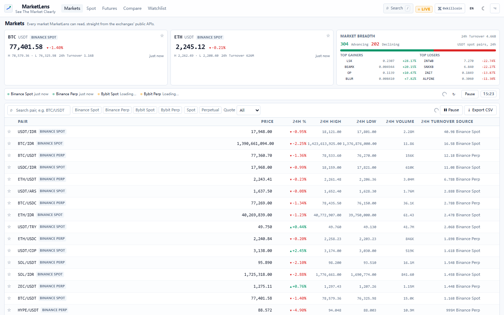
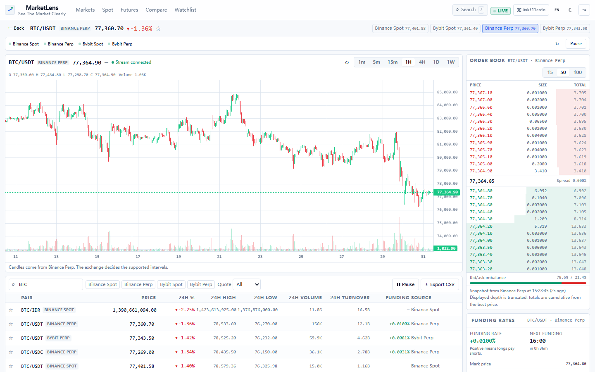
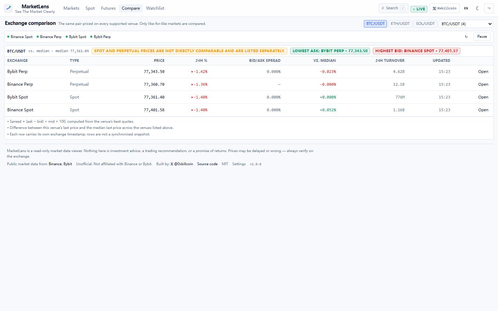
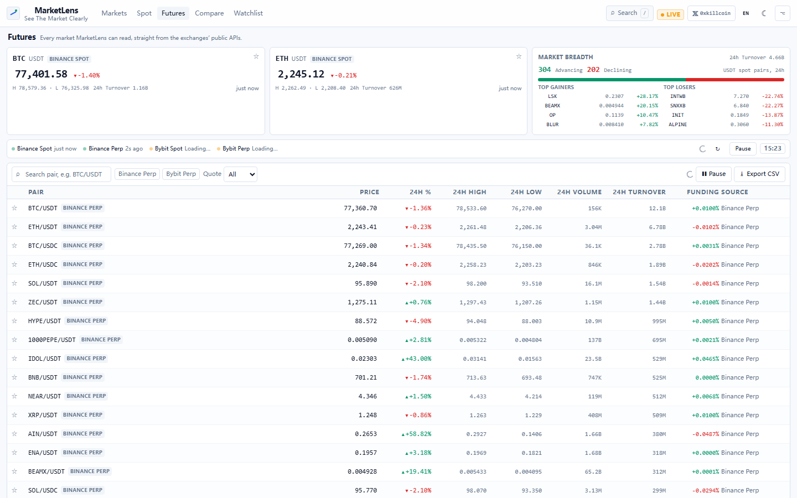
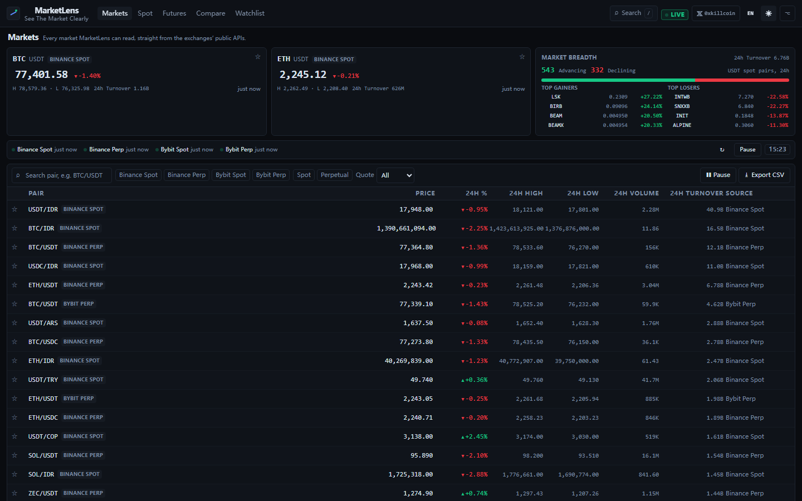
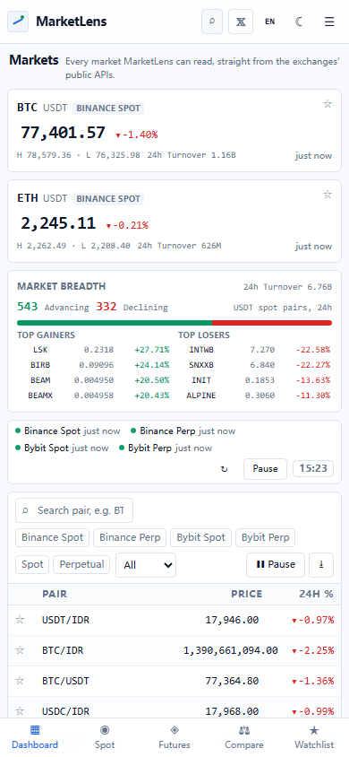
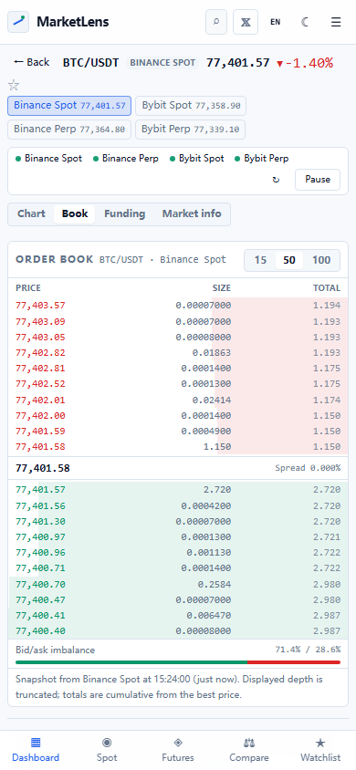

<div align="center">

# MarketLens

**把加密市场装进一个屏幕 · See The Market Clearly**

免费、开源的加密行情观察台。Binance 与 Bybit 的现货与永续合约，一屏高密度呈现 ——
不需要账号、不需要 API Key、没有后端。

[](https://github.com/iiiiiiiiiiiiiKK/marketlens/actions/workflows/ci.yml)
[](https://github.com/iiiiiiiiiiiiiKK/marketlens/actions/workflows/deploy.yml)
[](LICENSE)
[](package.json)

[**在线演示**](https://iiiiiiiiiiiiikk.github.io/marketlens/) · [English README](README.md) · 作者 𝕏：[**@0xkillcoin**](https://x.com/0xkillcoin)

</div>



---

## 为什么做这个

市面上的「行情面板」通常只有两种：需要注册和 API Key 的付费接口壳子，或者塞满硬编码数字的漂亮静态页。
MarketLens 都不是。它是交易所**已经公开**的行情接口之上的一枚**只读镜头**：
你看到的每个价格、每根 K 线、每一档订单簿、每一个资金费率，都来自你自己浏览器里真实的 HTTP 响应或 WebSocket 帧，
并且都带着来源与时间戳。

**它是**行情观察工具。**它不是**交易机器人、持仓管理、喊单服务或投资建议产品。

- 无需注册、无需登录、无需绑定交易所账户、无需 API Key。
- 没有需要信任的后端 —— 整个产品就是一个可以扔到 CDN 上的静态包。
- 没有模拟行情。接口失败时面板会明确报错，而不是编一个数字。
- 没有统计脚本、没有 Cookie、没有追踪。

## 功能

| | |
|---|---|
| **市场总览** | BTC / ETH 参考卡片、市场广度（上涨 / 下跌家数）、24 小时成交额、涨幅榜与跌幅榜 —— 全部基于 USDT 现货交易对实时计算。 |
| **四个市场一张表** | Binance 现货、Binance USDⓈ-M 永续、Bybit 现货、Bybit 永续并列展示，支持排序、搜索、按交易所 / 市场类型 / 计价币筛选，约 4,500 行数据使用窗口化渲染。 |
| **真正的 K 线** | Lightweight Charts® 蜡烛图 + 成交量，取自交易所自己的 K 线接口，1m → 1w；WebSocket 实时成交价直接推入最右一根 K 线。 |
| **订单簿** | 买盘 / 卖盘 / 累计量、深度背景条、买卖失衡比例、实时买卖价差，深度档位可切换（15 / 50 / 100 档）。 |
| **资金费率** | 当前费率、下次结算倒计时、带正负色条的历史曲线 —— 仅永续合约；现货市场会明确显示「不适用」，绝不虚构。 |
| **交易所对比** | 同一交易对在所有上线它的交易所的报价：最新价、24h 涨跌幅、成交额、最优买/卖价、价差（公开计算公式）与相对中位数偏离。 |
| **自选列表** | 多分组、上下移排序、任意表格点星加入，保存在 `localStorage`。 |
| **CSV 导出** | 每行都带交易所时间戳、本地接收时间与数据来源端点 —— 不把不同时刻的数据伪装成同一时刻快照。 |
| **实时状态诚实** | WebSocket 连接状态、各数据源新鲜度、「已暂停」标记、离线横幅、限流与超时的明确提示。 |
| **双语 + 双主题** | 简体中文 / English，自动识别并本地保存；深色（默认）与浅色主题。 |
| **移动端优先自适应** | 底部标签栏、K 线 / 订单簿 / 资金费率独立标签页、表格横向滚动、接近 44px 的触控目标，页面不会横向溢出。 |

<div align="center">

| 交易对工作站 | 交易所对比 |
|---|---|
|  |  |

| 合约与资金费率 | 浅色主题 |
|---|---|
|  |  |

| 移动端总览 | 移动端订单簿 |
|---|---|
|  |  |

</div>

## 数据来源

全部为**公开、只读、支持跨域**的官方接口，中间没有任何代理。每个适配器位于 `src/data/`，
均按官方文档与真实响应核对后实现。

| 交易所 | 市场 | 使用的接口 | 文档 |
|---|---|---|---|
| Binance | 现货 | `/api/v3/exchangeInfo`、`/api/v3/ticker/24hr`、`/api/v3/klines`、`/api/v3/depth`、`wss://stream.binance.com:9443/ws/<symbol>@miniTicker` | [Binance 现货 API](https://developers.binance.com/docs/binance-spot-api-docs) |
| Binance | USDⓈ-M 永续 | `/fapi/v1/exchangeInfo`、`/fapi/v1/ticker/24hr`、`/fapi/v1/premiumIndex`、`/fapi/v1/klines`、`/fapi/v1/depth`、`/fapi/v1/fundingRate`、`wss://fstream.binance.com/ws/<symbol>@miniTicker` | [U 本位合约 API](https://developers.binance.com/docs/derivatives/usds-margined-futures) |
| Bybit | 现货 | `/v5/market/instruments-info`、`/v5/market/tickers`、`/v5/market/kline`、`/v5/market/orderbook`、`wss://stream.bybit.com/v5/public/spot` | [Bybit V5 API](https://bybit-exchange.github.io/docs/v5/intro) |
| Bybit | 线性永续 | `/v5/market/instruments-info`、`/v5/market/tickers`、`/v5/market/kline`、`/v5/market/orderbook`、`/v5/market/funding/history`、`wss://stream.bybit.com/v5/public/linear` | [Bybit V5 API](https://bybit-exchange.github.io/docs/v5/intro) |

只列出交易所标记为 `TRADING`（衍生品还需 `PERPETUAL`）的合约。交易所下架的币种会随之从列表消失，
不会用缓存数据把它「留住」。

### 刷新模型与限流

- **行情轮询**：每个数据源每个周期一次请求。默认 10 秒（设置页可调 5–60 秒）。
  请求做去重（400ms 内相同 URL 共用一次调用）、永不并发重叠、页面隐藏时暂停、连续整体失败后自动降速。
- **实测请求权重**（读取 `X-MBX-USED-WEIGHT-1M` 响应头）：Binance 现货 `/ticker/24hr`（全量）= **80**，
  现货 `/depth`（100 档）= **5**，Binance 合约 `/ticker/24hr`（全量）≈ **40–50**，合约 `/premiumIndex`（全量）= **10**，
  合约 `/depth` = **5–7**。按默认 10 秒节奏，每分钟约消耗现货 480、合约 350 权重 ——
  远低于官方文档公布的每 IP 配额。
- **交易对元数据**（`exchangeInfo` / `instruments-info`）缓存 30 分钟，不会每隔 10 秒重新下载全量目录。
- **WebSocket** 只为当前打开的市场建立，并按订阅者计数：最后一个订阅者卸载（或切换交易对）时立即关闭。
  连接失败时保持 HTTP 轮询，并在界面上显示 `推送已断开 — 改用轮询`。
- Bybit 不返回限流响应头，因此 MarketLens 自我约束：同一接口同时只允许一个请求在飞。

## 架构

```
src/
├── data/                  # 每个交易所一个适配器 + 轮询/推送引擎
│   ├── base.ts            # MarketAdapter 契约与归一化（行情、K 线、盘口）
│   ├── binanceSpot.ts     # Binance 现货
│   ├── binanceFutures.ts  # Binance U 本位永续（24h 行情 + premiumIndex 合并）
│   ├── bybit.ts           # Bybit v5 公共逻辑（K 线周期码、分页、比例转百分比）
│   ├── bybitSpot.ts       # Bybit 现货
│   ├── bybitLinear.ts     # Bybit 线性永续（资金费率）
│   ├── liveTicker.ts      # 引用计数的 WebSocket 管理器，指数退避重连
│   ├── controller.ts      # 单飞轮询循环，感知页面可见性与离线
│   └── index.ts           # 注册表、标签、id 解析
├── hooks/                 # useKlines / useOrderBook / useFunding / useLiveTicker / useMediaQuery…
├── lib/                   # 类型、格式化、http（超时 + 去重）、i18n、选择器、CSV、路由
├── store/                 # zustand：markets（各数据源状态）、settings、watchlist
├── components/            # 导航、首屏、虚拟表格、图表、订单簿、资金费率、搜索面板、UI 组件
├── views/                 # TableView（总览/现货/合约）、PairView、CompareView、WatchlistView、SettingsView
├── App.tsx                # 外壳、哈希路由、错误边界、离线横幅
└── index.css              # 设计令牌（深/浅色）+ Tailwind 分层
```

**数据流**：`MarketAdapter.fetchTickers()` → 归一化的 `MarketTicker[]` →
`useMarkets` 状态（每个源独立的 `status / updatedAt / error`）→ 纯函数选择器
（`src/lib/selectors.ts`）→ 组件。界面里没有任何组件自己造价格，也没有组件绕过 hook 或控制器直接发请求。

**故障隔离**：每个数据源独占一份状态。某个交易所返回 429 只会影响它自己的行与徽标，
其余部分继续刷新；每个视图包裹 `ErrorBoundary`，每个面板都具备加载 / 空 / 错误 / 过期四种显式状态。

## 快速开始

```bash
git clone https://github.com/iiiiiiiiiiiiiKK/marketlens.git
cd marketlens
npm install
npm run dev          # http://localhost:5173
```

要求：Node 20+ 与现代浏览器。**不需要任何环境变量、密钥或 `.env` 文件** —— 应用只访问公开接口。

| 命令 | 作用 |
|---|---|
| `npm run dev` | Vite 开发服务器（热更新） |
| `npm run build` | 先 `tsc --noEmit` 类型检查，再产出 `dist/` |
| `npm run preview` | 本地预览构建产物 |
| `npm run lint` | ESLint（flat config + typescript-eslint + react-hooks） |
| `npm run typecheck` | `tsc --noEmit` |
| `npm test` | Vitest 单元 / 组件测试 |
| `npm run test:e2e` | Playwright：20 个确定性 UI 测试（桌面 + iPhone 13） |
| `npx playwright test --project=live` | 4 个直连真实交易所的联机测试 |
| `npx playwright test --project=screenshots` | 重新生成 `docs/screenshots/` 截图 |
| `npm run verify` | lint + 测试 + 构建 |

## 测试

| 测试项 | 命令 | 撰写时的结果 |
|---|---|---|
| ESLint | `npm run lint` | **0 error / 0 warning** |
| TypeScript 严格模式 | `npm run typecheck` | **0 error** |
| 单元 / 组件（Vitest + Testing Library） | `npm test` | **108 通过 / 10 个文件** |
| E2E 界面（Playwright，拦截交易所响应） | `npx playwright test --project=desktop --project=mobile` | **20 通过**（桌面 10 + iPhone 13 10） |
| E2E 联机（Playwright，真实接口） | `npx playwright test --project=live` | **4 通过** |
| 生产构建 | `npm run build` | **成功**（主包约 340 kB，图表包约 167 kB） |

覆盖内容：

- **适配器**：四家交易所的字段映射、Bybit 比例型百分比、K 线倒序还原、深度档位吸附、
  非 `TRADING` 过滤、`retCode` 异常抛出、资金费率仅永续存在。
- **选择器**：搜索归一化、多维筛选、空值永远沉底的排序、市场广度（仅 USDT 现货、不重复统计合约）、
  对比行与中位数偏离、参考交易所优先级。
- **推送**：连接共享与引用计数关闭、Binance/Bybit 帧解析、忽略其它交易对与畸形帧、
  重连退避、最后一个订阅者离开后不再重连。
- **状态**：自选增删 / 排序 / 分组与持久化往返（含损坏数据恢复）、主题与语言应用及持久化。
- **界面**：虚拟表格渲染、筛选、排序、加星、暂停 / 恢复、CSV 导出、骨架屏、显式错误态、
  现货资金费率「不适用」、分段控件 ARIA 状态、i18n 键对齐且无空串。
- **E2E**：四源行情总览、搜索 → 交易对页（图表 + 订单簿 + 资金费率）、刷新后自选仍在、
  主题与语言持久化、对比页公式说明、CSV 下载文件名、单源失败降级、移动端标签栏且页面不横向溢出、
  作者 𝕏 链接。

## 部署

构建产物是纯静态资源，任何 CDN 都能托管。`VITE_BASE` 控制公开路径。

### GitHub Pages（本仓库，自动）

`.github/workflows/deploy.yml` 以 `VITE_BASE=/marketlens/` 构建，并通过 Pages artifact 流程发布 `dist/`。
仓库里只需开启一次：

1. **Settings → Pages → Build and deployment → Source: GitHub Actions**
2. 推送 `main`（或手动运行 workflow）
3. 站点出现在 `https://<user>.github.io/marketlens/`

路由是基于 hash 的（`#/pair/binance-spot/BTCUSDT`），因此不需要任何重写规则或 404 兜底页。

### Cloudflare Pages

| 配置项 | 值 |
|---|---|
| 框架预设 | None / Vite |
| 构建命令 | `npm run build` |
| 输出目录 | `dist` |
| 环境变量 | `VITE_BASE=/`（根路径）或留空 |

免费额度：每月 500 次构建、静态请求不限量、全球 CDN。无需 Functions —— MarketLens 是纯静态。

### Vercel

| 配置项 | 值 |
|---|---|
| 框架 | Vite |
| 构建命令 | `npm run build` |
| 输出目录 | `dist` |
| 环境变量 | `VITE_BASE=/`（根路径）或留空 |

### 自托管

```bash
VITE_BASE=/ npm run build      # 然后用任意静态服务器托管 dist/
```

## 隐私与安全

- **没有后端、没有数据库、没有服务端密钥。** 仓库中不含任何凭据，也不读取 `.env`。
- **没有账号、没有 API Key、没有交易接口。** 应用只能读取公开行情；不存在能下单、划转资金或读取余额的代码路径，
  也从不索取或保存交易所凭据。
- **没有统计脚本、Cookie、指纹或第三方脚本。** 使用系统字体，唯一的外部请求就是上文列出的交易所接口。
- **仅本地保存。** `marketlens.settings.v1`（主题 / 语言 / 刷新间隔）与 `marketlens.watchlist.v1`（分组与自选）
  存放在浏览器 `localStorage`；清除站点数据即删除。
- **诚实的失败。** 超时、429/418/451 限流、畸形数据、跨域或网络失败都会以人类可读的原因 + 重试按钮呈现，
  绝不用缓存或合成数字顶替；过期数据仍可见，但来源徽标转为错误态并显示数据年龄。
- **交易所能看到你的 IP** —— 与你直接访问其网站完全一致。部分地区的限制来自交易所自身（HTTP 451），
  MarketLens 不会也不应该绕过。

## 已知限制

| 限制 | 说明 |
|---|---|
| 仅浏览器侧访问 | 地区封锁、企业 TLS 拦截或 ISP 级别阻断会导致某个交易所不可用。按设计不做服务端代理。 |
| 限流按访客 IP 计算 | 在共享 IP 上使用 5 秒刷新更容易触发 429；界面会提示并自动降速，默认 10 秒已足够保守。 |
| 现货 ≠ 永续 | 价格、流动性与 24h 统计口径不同。对比页会标记混入的市场类型，绝不在不同市场类型间静默求平均；中位数只使用表内最新价。 |
| 资金费率历史深度 | 取决于交易所公开接口（Binance 通常最近 60 次结算，Bybit 最多 200 条）。 |
| 每个市场一个 WebSocket | 表格使用轮询而非几十条并发推送 —— 有意为之，以远低于每 IP 推送配额。 |
| 历史 K 线不可继续向前翻页 | 每个周期加载 500 根，更早的数据未做分页。 |
| 盘口为截断展示 | 展示 15/50/100 档，累计量从最优价起算，并非完整盘口。 |
| 下架合约 | 交易所不再以 `TRADING` 上报时，该行会消失。 |

## 路线图

- 以同一 `MarketAdapter` 契约新增 OKX / Kraken 适配器。
- 为当前市场加入真正的盘口 WebSocket 增量（明确处理快照与增量）。
- K 线历史分页（向前回溯）与时区感知的时间轴。
- 纯本地的自选价格提醒（无服务端、无推送）。
- 交易对工作站的截图分享导出。

## 贡献

欢迎 Issue 与 PR，请先阅读 [CONTRIBUTING.md](CONTRIBUTING.md)。最重要的几条：
不伪造数据、不引入交易功能、不引入后端、所有文案必须双语齐全。

## 许可证

[MIT](LICENSE) © 2026 0xkillcoin

第三方许可证：React（MIT）、Vite（MIT）、Zustand（MIT）、Tailwind CSS（MIT）、
Lightweight Charts®（Apache-2.0）、Vitest（MIT）、Playwright（Apache-2.0）。
均为 MIT / Apache-2.0 兼容许可，因此本项目以 MIT 发布。

---

<div align="center">

**免责声明。** MarketLens 是非官方、只读的行情观察工具，与 Binance、Bybit 无隶属关系。
页面内容不构成投资建议、交易推荐或收益承诺。资金费率是多空双方之间的定期支付 ——
不是收益、不是年化利率、不代表未来价格。行情可能存在延迟或错误，操作前请以交易所数据为准。

作者 [**@0xkillcoin**](https://x.com/0xkillcoin) · [源代码](https://github.com/iiiiiiiiiiiiiKK/marketlens)

</div>
